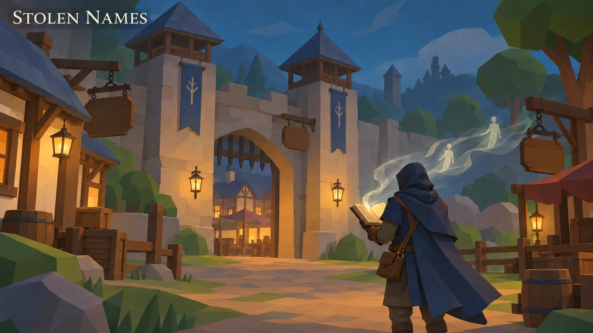
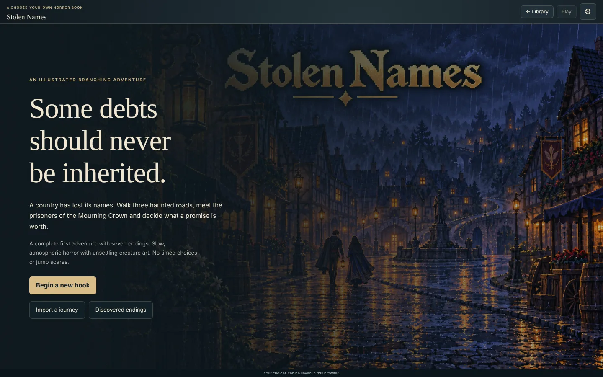
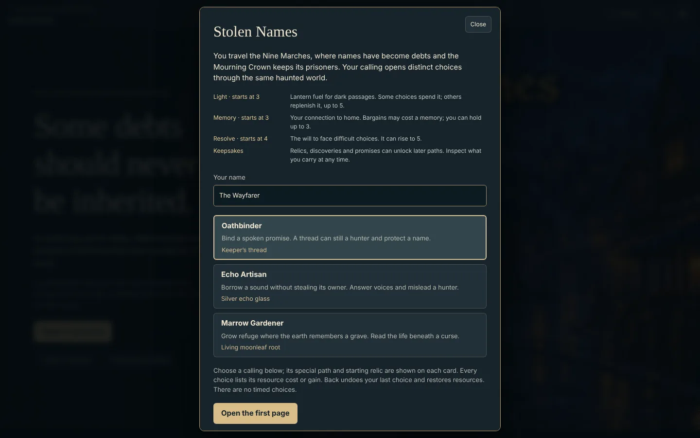
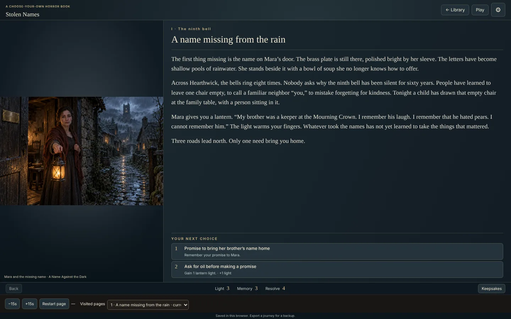
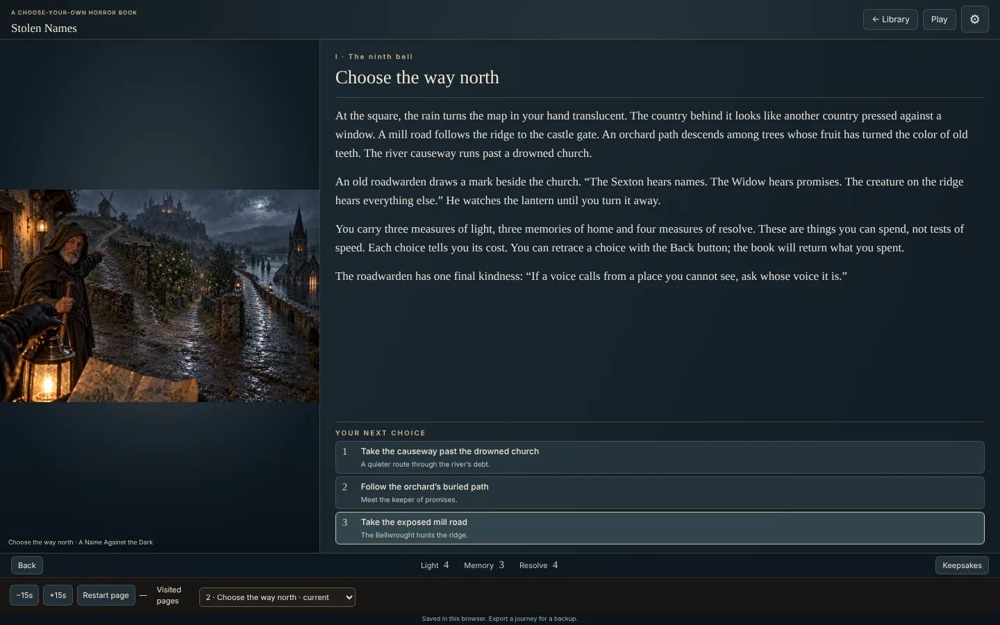
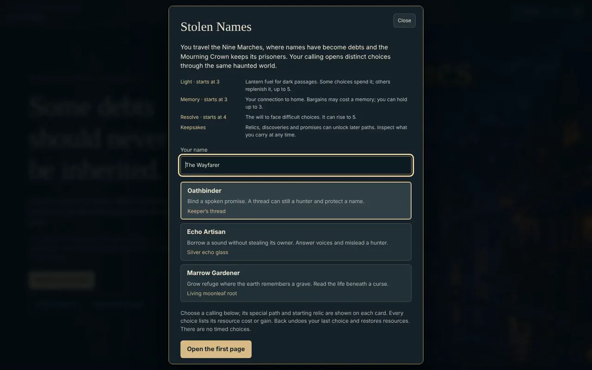

# Stolen Names

**Some debts should never be inherited. A country has lost its names.**

[**▶ Live demo**](https://beebopcat.github.io/stolen-names/) · [**Play on caseyshingledecker.com**](https://caseyshingledecker.com/demos/top-secret/borrowed-names/) · [**Source**](https://github.com/Beebopcat/stolen-names)

[](https://beebopcat.github.io/stolen-names/)

*Promotional cover art; gameplay screenshots appear below.*

## What it is

An illustrated choose-your-own horror and dark-fantasy book: walk three haunted roads, meet the prisoners of the Mourning Crown and decide what a promise is worth in the Nine Marches. The cover subtitle reads "A tale of the Nine Marches".

## Screenshots

| | |
|:--:|:--:|
|  |  |
| <sub>Stolen Names cover over a rainy night street, with the Begin a new book and Import a journey buttons.</sub> | <sub>Setup dialog listing the callings Oathbinder, Echo Artisan and Marrow Gardener, with an Open the first page button.</sub> |
|  |  |
| <sub>Story page A name missing from the rain, with narrative text and two numbered choices.</sub> | <sub>Story page Choose the way north, with a lantern-lit street illustration and three numbered choices.</sub> |

### Video

[](docs/media/clip.mp4)

*Click the poster to open the short screen recording (docs/media/clip.mp4).*

## How to use

1. Begin a new book, continue a saved journey or import a journey.
2. Choose a calling (the setup dialog lists Oathbinder, Echo Artisan and Marrow Gardener) and a road, then open the first page.
3. Read each page and pick one of the numbered choices. Light, Memory, Resolve and keepsakes change which choices are open.
4. Use Back to restore the previous page and its resources.
5. Use the Keepsakes, Visited pages, Current journey and Restart page controls to review where you have been; the narration controls offer -15s and +15s.
6. Export a journey to keep it beyond the browser, and import it later. Progress is saved in your browser.

### Quick start


<sub>Story page Choose the way north, with a lantern-lit street illustration and three numbered choices.</sub>

## Features

- Three callings, three haunted roads and seven endings
- Slow, atmospheric horror with unsettling creature art; no timed choices or jump scares
- A discovered-endings tracker
- Keepsakes, visited pages and a current-journey view
- Journey export and import, with saves kept in the browser
- Narration controls (-15s / +15s); narration plays only where recordings have been verified

## The story behind it

The book is set in the Nine Marches, the same setting as the open-world RPG The Nine Marches (see the lantern-gate repository). Its tagline is "Some debts should never be inherited. A country has lost its names."

## Built with

- HTML and JavaScript (app.js)
- Browser localStorage, with journey export/import

## Run it locally

This is a static web project, so any local web server works:

```bash
git clone https://github.com/Beebopcat/stolen-names.git
cd stolen-names
python -m http.server 8000
```

Then open http://localhost:8000 in your browser.

## Content notes

This is a work of dark fantasy and horror for adult readers. It contains horror themes and unsettling creature art. There are no timed choices or jump scares.

## Credits & disclaimers

Built by Casey Shingledecker with AI-assisted development.

## More projects

- Portfolio and live demos: https://caseyshingledecker.com/
- All repositories: https://github.com/Beebopcat

## License

Copyright (c) 2026 Casey Shingledecker. All rights reserved. Source-available for viewing and for personal, non-commercial running only; this is not open source. See [LICENSE](LICENSE). See also [NOTICE.md](NOTICE.md). Other people's material keeps its own license.
